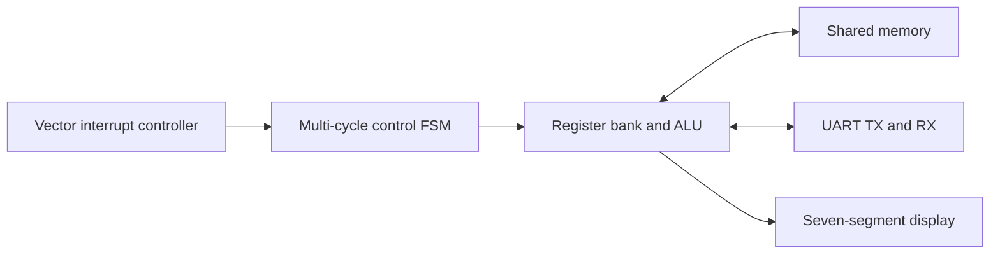

# Multi-Cycle ARM-Style Processor with Interrupts and UART

**VHDL · Computer Architecture · FSM Control · Interrupts · UART · FPGA**

[中文](#中文) | [English](#english) | [Français](#français)

[项目报告 · Project report · Rapport de projet](docs/ARM.pdf)

**Authors / 作者 / Auteurs: KE YU & HONGYI CAI**

## 中文

### 项目概述

本项目使用 VHDL 构建简化的 32 位 ARM 风格多周期处理器，以有限状态机调度取指、译码和执行过程，并在基础处理器上集成向量中断控制器与内存映射 UART，探索处理器、存储器和外设的协同设计。

### 功能与源码

| 文件 | 功能 |
| --- | --- |
| `src/MAE.vhd` | 多周期指令控制状态机 |
| `src/arm_UART.vhd` | 处理器集成，实体名为 `ARM` |
| `src/DataPath_UART.vhd` | UART 扩展数据通路，实体名为 `DataPath` |
| `src/DualPortRAM.vhd` | 共享指令/数据存储器与演示程序 |
| `src/VIC.vhd` | 中断选择与服务接口 |
| `src/uart_conf.vhd` | UART 地址选择、发送触发与接收数据接口 |
| `src/uart_tx.vhd`、`src/uart_rx.vhd` | 串口发送与接收 |
| `src/fdiv.vhd` | 波特率节拍产生，默认 50 MHz / 115200 baud |
| `src/top_level.vhd` | FPGA 顶层与显示接口 |

数据通路地址 `0x40` 用于发送低 8 位数据，`0x41` 在接收数据有效时选择 UART 输入。基础处理器与 UART 扩展分别位于 `partie1-3/` 和 `partie4/`，主工程使用根目录的 `src/`；各阶段包含同名实体，应分别编译。

### 演示结果

项目报告展示了基础程序结果 `0x37`、中断处理后的 `0x38` 和 `0x3A`，以及 UART 发送 `Hello World !` 并根据接收字符更新消息的演示。这些是原项目报告记录的结果，当前版本尚未重新编译或进行硬件验证。

### 使用方式

在 Quartus Prime 中打开 `Processeur_Multicycle.qpf`，revision 和顶层实体均为 `top_level`。工程配置为 Quartus Prime 23.1、Cyclone V `5CSEMA5F31C6`、50 MHz 时钟。`KEY(0)` 用于复位，`KEY(1)`–`KEY(3)` 接入中断，`GPIO_0(0)` / `GPIO_0(1)` 分别为 TX / RX。

仿真入口为 `simu/ARM_simu.do`，选择 `ARM_UART_TB`。脚本按自身目录解析路径，测试平台使用20 ns（50 MHz）时钟，运行1200微秒。`UART_simu.do` 和 `Datapath_simu.do` 也进入同一UART测试平台。当前是波形观察型测试，不提供自动通过/失败判定。

### 技术范围

本项目实现教学用指令子集和简化的状态/中断语义，不是完整 ARM7TDMI。UART 握手与时序、仿真接口及 FPGA 引脚需要在目标环境验证。更多仿真配置细节见 [运行说明](docs/USAGE.md)。

## English

### Overview

A simplified 32-bit ARM-style multi-cycle processor in VHDL. A finite-state machine sequences instruction fetch, decode and execution. A vector interrupt controller and memory-mapped UART extend the core to demonstrate processor, memory and peripheral integration.

### Features and Structure

- `src/MAE.vhd`: instruction control state machine.
- `src/arm_UART.vhd`: processor integration, entity `ARM`.
- `src/DataPath_UART.vhd`: extended datapath, entity `DataPath`.
- `src/DualPortRAM.vhd`: shared instruction/data memory and demonstration program.
- `src/VIC.vhd`: interrupt selection and service interface.
- `src/uart_conf.vhd`, `src/uart_tx.vhd`, `src/uart_rx.vhd`: UART interface, transmitter and receiver.
- `src/fdiv.vhd`: baud tick generator, defaulting to 50 MHz / 115200 baud.
- `src/top_level.vhd`: board interface and display.

Datapath address `0x40` triggers transmission of the low byte; `0x41` selects received data when valid. `partie1-3/` contains the basic processor stage and `partie4/` the UART extension. The main project uses root-level `src/`. Compile stages separately because entity names overlap.

### Demonstrations

The project report documents a base result of `0x37`, interrupt examples producing `0x38` and `0x3A`, and a UART demonstration sending `Hello World !` and updating the message from received characters. These are results from the original report; this version has not been rebuilt or tested on hardware.

### Usage

Open `Processeur_Multicycle.qpf` in Quartus Prime, with revision and top-level entity `top_level`. The configuration targets Quartus Prime 23.1, Cyclone V `5CSEMA5F31C6` and a 50 MHz clock. `KEY(0)` resets the design, `KEY(1)`–`KEY(3)` feed interrupts, and `GPIO_0(0)` / `GPIO_0(1)` provide TX / RX.

Use `simu/ARM_simu.do` as the simulation starting point; it selects `ARM_UART_TB`. Paths resolve relative to the script. The testbench uses a 20 ns (50 MHz) clock and runs for 1200 microseconds. `UART_simu.do` and `Datapath_simu.do` select the same UART testbench. This is a waveform-based test, not an automated pass/fail test.

### Scope

The instruction subset and interrupt/status semantics are simplified for teaching. This is not a complete ARM7TDMI implementation. UART timing, testbench interfaces and board pins require validation in the target environment. See [usage notes](docs/USAGE.md) for simulation details.

## Français

### Présentation

Processeur multicycle 32 bits inspiré d’ARM, réalisé en VHDL. Une machine à états finis organise la lecture, le décodage et l’exécution des instructions. Un contrôleur d’interruptions vectorisées et une UART mappée en mémoire complètent le cœur pour étudier l’intégration du processeur, de la mémoire et des périphériques.

### Fonctionnalités et structure

- `src/MAE.vhd` : machine à états de commande.
- `src/arm_UART.vhd` : intégration du processeur, entité `ARM`.
- `src/DataPath_UART.vhd` : chemin de données étendu, entité `DataPath`.
- `src/DualPortRAM.vhd` : mémoire partagée et programme de démonstration.
- `src/VIC.vhd` : sélection et gestion des interruptions.
- `src/uart_conf.vhd`, `src/uart_tx.vhd`, `src/uart_rx.vhd` : interface, émission et réception UART.
- `src/fdiv.vhd` : génération du rythme série, réglage par défaut de 50 MHz / 115200 bauds.
- `src/top_level.vhd` : interface carte et affichage.

L’adresse `0x40` du chemin de données déclenche l’émission de l’octet faible ; `0x41` sélectionne la donnée reçue lorsqu’elle est valide. `partie1-3/` contient le cœur de base et `partie4/` l’extension UART. Le projet principal utilise `src/` à la racine. Compiler les étapes séparément, car certaines entités portent le même nom.

### Démonstrations

Le rapport présente un résultat initial de `0x37`, des interruptions produisant `0x38` puis `0x3A`, et une démonstration UART envoyant `Hello World !` puis modifiant le message à partir des caractères reçus. Ces résultats proviennent du rapport initial ; cette version n’a pas été recompilée ni testée sur carte.

### Utilisation

Ouvrir `Processeur_Multicycle.qpf` dans Quartus Prime, avec la révision et l’entité principale `top_level`. La configuration cible Quartus Prime 23.1, le Cyclone V `5CSEMA5F31C6` et une horloge de 50 MHz. `KEY(0)` commande la remise à zéro, `KEY(1)`–`KEY(3)` les interruptions, et `GPIO_0(0)` / `GPIO_0(1)` correspondent à TX / RX.

Le point d’entrée de simulation est `simu/ARM_simu.do`, qui sélectionne `ARM_UART_TB`. Les chemins sont résolus par rapport au script. Le banc utilise une horloge de 20 ns (50 MHz) et s’exécute pendant 1200 microsecondes. `UART_simu.do` et `Datapath_simu.do` sélectionnent le même banc UART. Il s’agit d’une observation des chronogrammes, sans verdict automatique de réussite ou d’échec.

### Périmètre

Le jeu d’instructions et la gestion des états/interruptions sont simplifiés à des fins pédagogiques. Il ne s’agit pas d’un ARM7TDMI complet. Les échanges UART, les interfaces de simulation et les broches doivent être validés sur la plateforme cible. Voir les [notes d’utilisation](docs/USAGE.md), en anglais, pour les détails de simulation.
